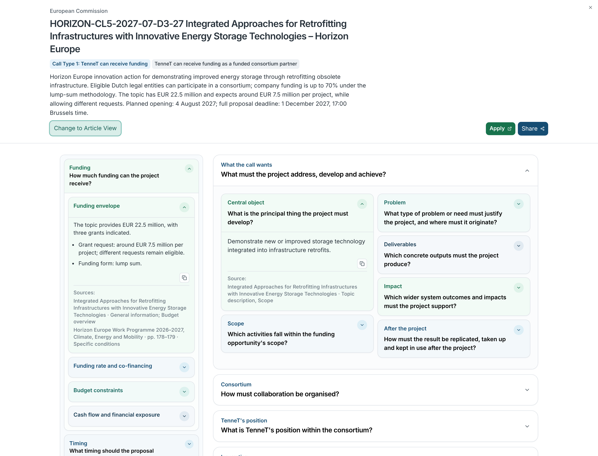
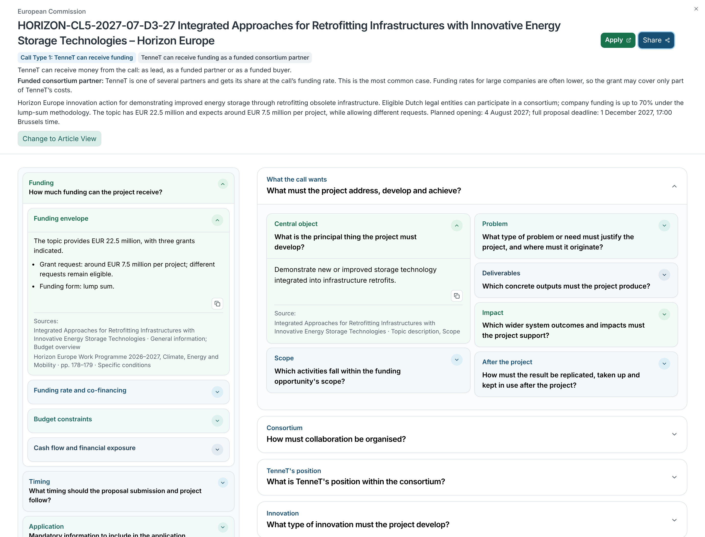
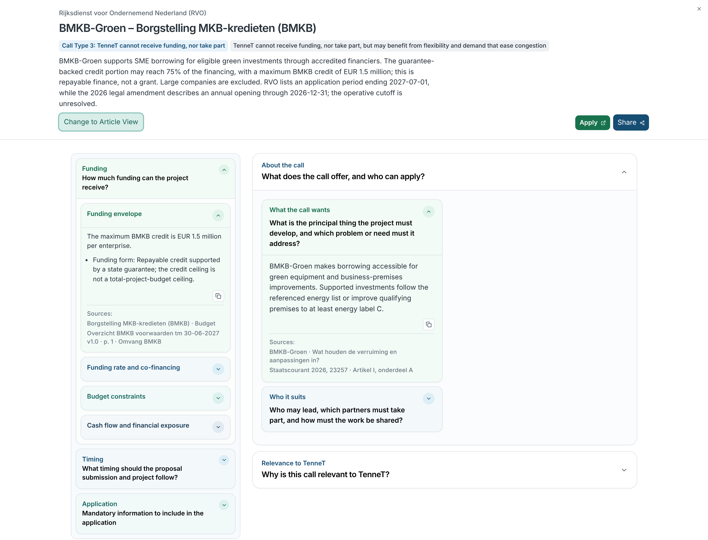
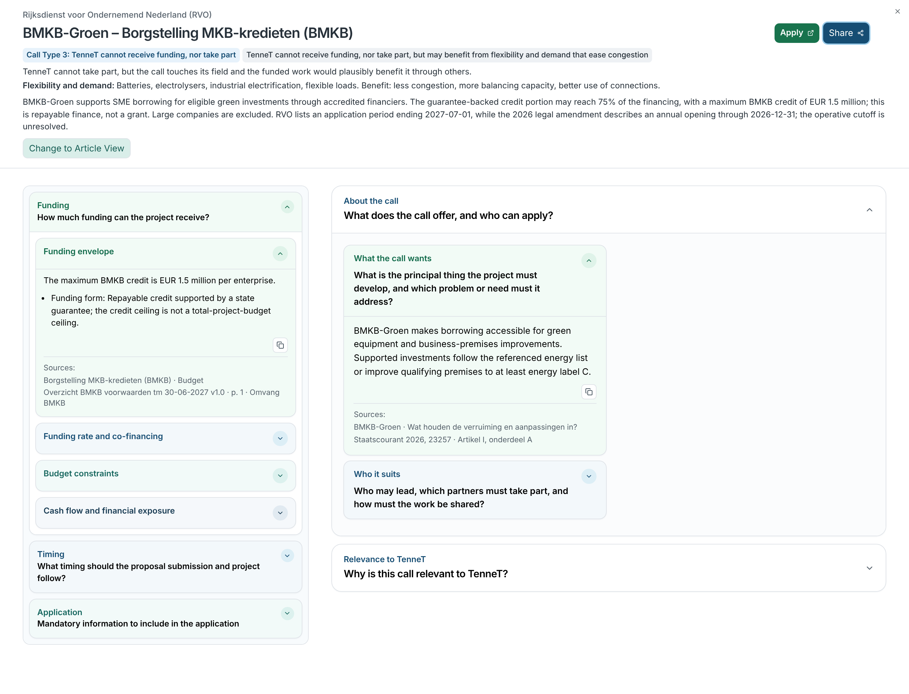
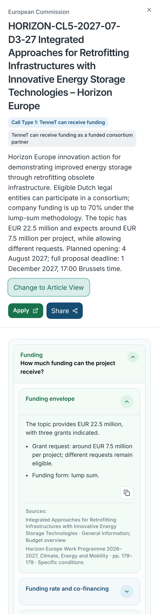
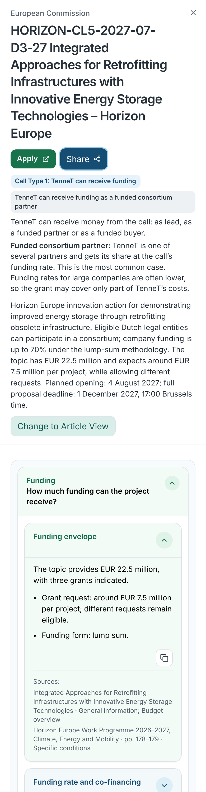
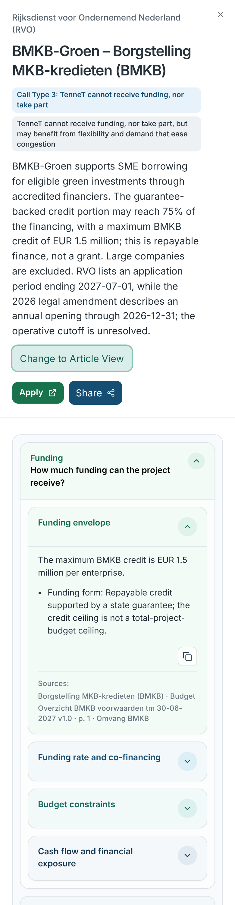
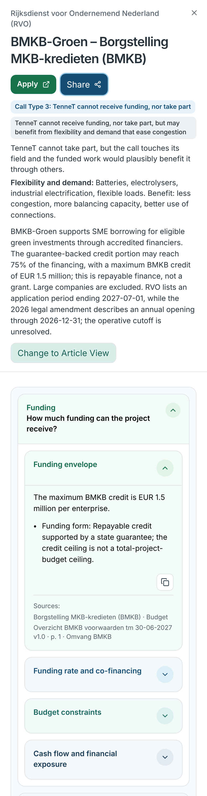

# Design changes to the detail view

16 November 2026. Four design changes: the header of the detail view, the column split, the cards inside the detail view, and the logo. No data, ranking, filter or agent file changed.

## Read this first

1. **`call_types.json` does not have the fields the prompt describes.** It has no `display`, `label`, `starter` or `completion`; each type and category has a `tag`, `value` (categories only) and `definition`. So the tags keep today's wording, and the definitions have no "Call Type I" lead-in, because no file text says that. I did not invent one.
2. **The definitions show no category code.** The prompt's example reads `C1.1 · <category value>: <category definition>`. The earlier rule for this site is that no category code appears on screen, so the line reads `<category value>: <category definition>`. Say so if you want the code shown; it is a one-line change.
3. **The sources text is not smaller in pixels.** It was already 12 px, the lowest size the prompt allows. It is lighter in weight instead (see change 3).
4. **The old logo was shown nowhere except as the browser-tab icon.** The header only had an empty space of the logo's size. The new logo is now in that space. The tab icon was later replaced with its own file, `web/public/favicon.png`.
5. **`check-data` still ends with a failure**, as before this change: the two real records have null project dates. The reports and the call types pass.
6. **There is no lint script** in this repository. I ran the type check (`tsc --noEmit`) in its place.

## Change 1: executive summary and call-type header

Files: `web/src/components/detail-view.tsx`, `web/src/components/call-type-tags.tsx`, `web/build/call-type-tags.mjs`, `web/build/load-data.mjs`, `web/src/lib/types.ts`.

| What | Before | After |
| --- | --- | --- |
| Summary width | `max-w-5xl` (768 px on a desktop), inside a column that also made room for the Apply and Share buttons, inside a 1200 px header | No maximum; the full inner width of the header |
| Summary font size | `text-base`: 14 px on a desktop, 16 px on a phone | `text-sm`: 13 px on a desktop, 14 px on a phone |
| Summary line height | 1.55 | 1.5 |
| Summary height at 1440 px (both real calls) | 5 lines, 108 px | 3 lines, 59 px |
| Summary height at 390 px | 12 lines, 298 px | 10 lines, 210 px |
| Header padding, top and bottom | `py-5 sm:py-6` | `py-4 sm:py-5` |
| Margins above tags, summary and the view button | `mt-3` each | `mt-2.5` each |
| Apply and Share | Beside the whole header block | Beside the title only |
| Order | Title, tags, summary | Title, tags, definitions, summary |

- **What stopped the text:** the `max-w-5xl` on the summary and on the title, and the flex row that put the buttons beside the whole text column.
- **Tags:** same component, wording and look as before. They are now outside the title row, so they always sit on their own line under the title and wrap.
- **Definitions:** a new list under the tags (`CallTypeDefinitions`). The first line is the `definition` of the record's type. Then one line per code in `category_codes`: the category's `value` in bold, a colon, and its `definition`. 13 px on a desktop, 14 px on a phone, no box. The site build now also bundles each category's `value`.
- The summary and the definitions are never cut, clamped or collapsed.
- The whole header is 30 px shorter at 1440 px for the Type 1 call (346 to 316 px) and 18 px shorter for the Type 3 call (285 to 267 px), with the two definition lines added. At 390 px it is taller (800 to 843 px, and 692 to 701 px), because the definitions add more lines than the smaller summary saves.

## Change 2: column split

Files: `web/src/components/detail-view.tsx`, `web/src/components/article-view.tsx`, `web/src/components/styles.ts`.

| Width | Left before | Content before | Left after | Content after | Outer margin after | Gap after |
| --- | --- | --- | --- | --- | --- | --- |
| 1280 px | 345 px (27%) | 783 px (61%) | 402 px (31.4%) | 781 px (61%) | 32 px | 33 px |
| 1440 px | 345 px (24%) | 783 px (54%) | 453 px (31.4%) | 879 px (61%) | 36 px | 37 px |
| 1920 px | 345 px (18%) | 783 px (41%) | 603 px (31.4%) | 1171 px (61%) | 48 px | 49 px |

- **Before:** a fixed left column (`--tool-sidebar-width`, 292 px, or `--tool-sidebar-wide-width`, 345 px) inside a container capped at `--tool-detail-width` (1200 px). That cap was the parent squeezing the layout: at 1920 px the two columns used 59% of the page.
- **After:** from 1024 px wide, the container follows the page with a margin of 2.5% at each side, and the grid is `minmax(0,34fr) minmax(0,66fr)` with a gap of 2.7%. The left column is 34% and the content 66% of the space between the margins.
- **What I chose:** 34/66 instead of 35/65. With the margins and the gap, 35/65 leaves the content column just under 60% of the page.
- The header uses the same container, so the title and summary line up with the columns. So do the Article View and the "report not written yet" page; their own contents did not change.
- Below 1024 px nothing changed: the columns stack.
- The left column now breaks long words anywhere (`overflow-wrap: anywhere`, was `break-words`), so a long URL or number cannot push it wider.
- The two sidebar width variables in `globals.css` are no longer used. I left them in place.

## Change 3: cards in the detail view

Files: `web/src/components/detail-view.tsx`, `web/src/components/plain-text.tsx`.

| What | Before | After |
| --- | --- | --- |
| Answer colour | `#27313a` (inherited) | `#000` |
| Sources size | 12 px | 12 px |
| Sources weight | 500 | 400 |
| Sources letter spacing | 0.01em | none |
| Sources colour | `#6b7781`, contrast 4.35:1 on the card | `#56616b`, contrast 6.0:1 |
| Body behind the left column's cards | white at 75% | white, opaque |
| Copy button on a card | white at 85% | white, opaque |

- **Sources size.** `text-xs` is 12 px on every screen, which is the floor the prompt sets, so I could not make it smaller. Against the answer it is 12 px next to 13 px (left column) or 14 px (content) on a desktop, and 14 px or 16 px on a phone. It is less prominent through its lighter weight.
- **Sources colour.** The old grey failed the 4.5:1 rule (4.35:1), so the new one is darker, not lighter. This pulls against "less prominent"; the contrast rule won.
- **Card background.** The cards themselves were already opaque: a pale tint (for example `#f2fbf6`). The two see-through layers were the ones in the table. I kept the tints, because the colour palette is not to change.
- **Fading.** No card text had `opacity` below 1. Measured on the open cards at 1440 px and 390 px: titles `#116a4a` 6.25:1, questions and answers `#000` 19.9:1, sources 6.0:1. The other three title colours of the palette (`#164d73`, `#17675f`, `#173a52`) are darker than the first on equally pale tints.
- The result cards on the results list are untouched.

## Change 4: logo

Files: `web/public/innovation-funding-desk-logo.png` (new), `web/src/App.tsx`.

- The attached image (778 × 771 px, transparent corners) is saved next to the old file.
- The header's empty logo space (`h-16 w-16`, `sm:h-20 sm:w-20`) now holds the image, at the same height: 60 px on a desktop, 64 px on a phone, with the width following the image's own ratio. Alt text: "Innovation Funding Desk logo". The header shows on every screen, including the landing page; the landing page has no logo of its own.
- At 2× screens the 778 px file is drawn at up to 128 px, so it is sharp. It sits on the page background `#f6f7f9`; the pale blue square and the dark blue strokes both read clearly on it.
- **Tab icon:** later replaced. `web/index.html` now points to `web/public/favicon.png`, and the old `funding-desk-logo.png` (the drawing with two arrows) was deleted. There is no social-preview image.

## Checks

- Build: passes. Type check: clean. Unit tests: 62 pass (one new, on the definitions).
- `check-data`: reports and call types pass; it ends with the same four problems as before (null project dates in the two real records).
- No file under `web/src/lib/` that ranks or filters was touched, and the tests that pin scores and order still pass.
- In a headless browser, at 1280, 1440, 1920 and 390 px, on the Type 1 call and the Type 3 call: the numbers in the tables above; the order title, tags, definitions, summary; every definition on screen identical to a `definition` in `call_types.json`; no sideways scrolling; columns stacked at 390 px.

## Screenshots

Before and after, cards view, with the first section and first card of each column opened.

| | Before | After |
| --- | --- | --- |
| Type 1, 1440 px |  |  |
| Type 3, 1440 px |  |  |
| Type 1, 390 px |  |  |
| Type 3, 390 px |  |  |

## Not tested

- A call with two category codes on the detail view in a browser: neither real record has two. The unit test covers the two definitions, and the tags use the component checked with two codes in the previous round.
- Browsers other than Chromium, and a real Vercel deployment.
- The logo on a 3× screen.

## Suggestions I did not apply

1. *Very long summary lines.* At 1920 px the summary runs 1824 px wide at 13 px, about 280 characters a line. A cap of about 1100 px would read better, but the prompt asks for the full width.
2. *White cards.* If the tinted cards still look washed out, a white card with the coloured border kept would fix it. It changes the palette, so I left it.
3. *The tab icon.* Pointing it to the new logo is a one-line change in `web/index.html`, after which the old file can be deleted.
4. *A lead-in for the type's definition.* Adding a `display` text per type to `call_types.json` (for example "Call Type I") would let the first definition line start with it.
5. *The unused sidebar width variables* in `globals.css` can be removed.

## Later the same day: filter, type tags and summary removed

After seeing the result, these were taken out again. Where this section and the text above differ, this section is the current state.

- **Results page.** The call-type filter box, the "Showing X of Y" line and "Clear filters" are gone, with their code (`web/src/lib/call-type-filter.ts`, `web/src/components/call-type-filter.tsx`) and tests. Section 10 of `RESTRUCTURE_NOTES.md` describes the filter as it was.
- **Type tag.** The blue tag of the call type ("Call Type 1: …") is no longer shown on the result cards or the detail page. The grey category tags stay.
- **Type definition.** The detail page no longer shows the definition of the call type. It shows one line per category: its `value` and `definition`.
- **Executive summary.** No longer shown anywhere, and no longer bundled into the site. The header of the detail page is now title, category tags, category definitions.
- **Sources.** 10 px (was 12 px), on every screen.
- **`check-data`** no longer asks for the `types` list or its tags, because the site does not use them. The category rules stay.

Not changed: `resources/call_types.json` still holds `types` with their tags, the FO records and the record template still hold `executive_summary`, and the SA agent still writes it and its gate still requires it. Removing the field from the record format means changing `SA_agent.md`, the template and the gate together.
